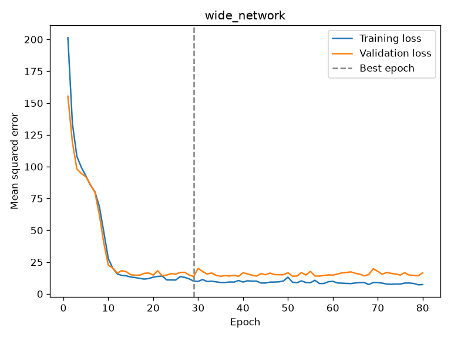
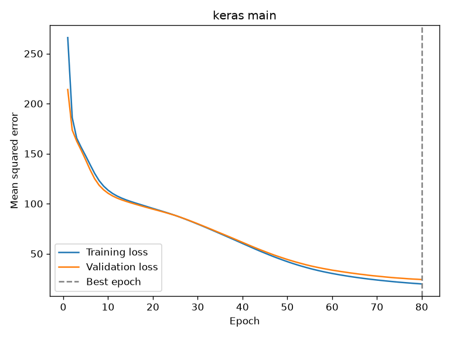

# Lakeshore Bike Demand: the same model in PyTorch and Keras

## What it does

This predicts how many bikes a Lakeshore station will rent in the next hour from the hour, weather, weekend flag, and station type. The number is compared with guessing the training average and with a straight-line model. The same network is then built in Keras, checked against the PyTorch weights, and trained again so the team can compare the two frameworks. The written recommendation is in [COMPARISON.md](COMPARISON.md).

## How to run it

```bash
conda env create -f environment.yml
conda activate lab08-same-model-twice
python train.py
python train_keras.py
python compare.py
python -m ruff format --check .
python -m ruff check .
python -m pytest
```

`python train.py` rewrites the PyTorch files in `reports/`. `python train_keras.py` rewrites `reports/history_keras.csv` and `reports/learning_curves_keras.png`, and it also writes `reports/keras_main.keras`. That checkpoint is about 81 KB and is listed in `.gitignore`, so a clone does not contain it until the script is run. `python compare.py` rewrites `reports/comparison.csv`. The seed is fixed, and each framework is limited to one thread, so the errors should match on this computer. The seconds in the comparison table can move a little. Another computer can differ in the last digits.

## Data and split

`bikes_data.py` builds 6,000 station-hours with seed 2026. The table is split 60% / 20% / 20% into training, validation, and test before anything is fitted. The numeric scaler and the station-type encoder are fitted on the training rows only, then applied to the other rows. The rental count is not scaled, so the error stays in bikes. The Keras script calls the same functions. It does not fit a second scaler.

Hour is left as a number from 0 to 23. Average rentals are about 3 bikes overnight, rise to about 23 at 08:00, fall through midday, and rise again to about 22 at 18:00. That is two peaks, not a straight line.

## Model and training

The shipped PyTorch network has four hidden layers of 256 units, each with ReLU, and a final value with no activation. The loss is mean squared error. Adam uses learning rate 0.001 and batches of 64. Training runs for 80 epochs. NumPy, Python, PyTorch, and the training-loader generator all use seed 2026. After training, the weights from the epoch with the lowest validation loss are put back.

## Results

| Model | Validation MAE | Test MAE |
| --- | ---: | ---: |
| Training mean | 9.95 | 9.85 |
| Linear regression | 9.03 | 8.76 |
| Network | 2.50 | 2.39 |

The linear model barely beats the average. A straight line cannot follow a morning peak and an evening peak with a dip in between, and the plot of rentals against hour is exactly that shape. The network's validation error is about 2.5 bikes, and the one test look is 2.39. Those two numbers are close.



The training and validation losses fall together for about 30 epochs. The best validation loss is epoch 29. After that the training loss keeps drifting down while the validation loss flattens, so the later epochs are a mild overfit. Restoring epoch 29 avoids using those later weights.

## Experiments

Each run changes one thing from the two-layer network of width 64. The shipped model is the run with the lowest validation loss.

| Run | Change | Best epoch | Best validation MAE | Final training loss | Final validation loss |
| --- | --- | ---: | ---: | ---: | ---: |
| main | width 64, 2 layers, learning rate 0.001 | 79 | 3.16 | 18.66 | 21.00 |
| high_learning_rate | learning rate 0.5 | 31 | 4.07 | 38.70 | 35.20 |
| wide_network | width 256, 4 layers | 29 | 2.50 | 7.37 | 16.66 |

The small network is still learning at epoch 79. Its training and validation curves stay on top of each other and are still falling, so it is underfitting rather than memorizing. It is fine, and it is not finished.

The learning rate of 0.5 is unstable. The first training loss jumps above 2,500, then the curves crash down and keep jittering. The best epoch is only 4.07 bikes off, worse than either calmer run. The curves show the step size is too large.

The wide network is the one that was shipped. It reaches a low loss by epoch 29, and the two curves move together up to that point. Afterward the training loss stays below the validation loss, which is the start of overfitting, and the saved weights are the earlier epoch. Curves for the other runs are `reports/learning_curves_main.png` and `reports/learning_curves_high_learning_rate.png`.

## The Keras version

`keras_model.py` builds that same stack in Keras, with the hidden size and the depth as arguments. `copy_torch_weights` transposes each PyTorch weight, because a Dense kernel is stored as (inputs, outputs). After the copy, the two networks match on the checked rows to within 1e-5.

The Keras main run uses the Lab 07 main settings, not the wide network: width 64, two hidden layers, learning rate 0.001, batch size 64, 80 epochs, seed 2026. Patience equals 80, so early stopping does not cut the run short. The best validation loss is epoch 80. Validation MAE is 3.46 bikes and the one test score is 3.28. The curves are still falling at the last epoch, which matches the PyTorch main run.



`compare.py` trains that main configuration in both frameworks on seeds 2026, 2027, and 2028. Each finished model is scored on the test rows once.

| Framework | Seed | Best epoch | Validation MAE | Test MAE | Seconds |
| --- | ---: | ---: | ---: | ---: | ---: |
| pytorch | 2026 | 79 | 3.16 | 3.07 | 5.6 |
| keras | 2026 | 80 | 3.46 | 3.28 | 7.9 |
| pytorch | 2027 | 80 | 2.96 | 2.94 | 3.0 |
| keras | 2027 | 80 | 3.18 | 3.14 | 7.9 |
| pytorch | 2028 | 80 | 3.67 | 3.53 | 3.0 |
| keras | 2028 | 80 | 3.31 | 3.11 | 8.1 |

The test error averages 3.18 bikes for both. Keras takes about 8 seconds and PyTorch takes about 3 to 6. The recommendation, and what the team would give up, is in [COMPARISON.md](COMPARISON.md).

## Tests

Lab 07's tests still cover the split, the PyTorch output shape, and the weight update. The Keras tests check one value per row, the parameter count at hidden sizes 8, 32, and 128, the transposed weight copy, the shared prepared rows, memorizing one batch, a saved and reloaded model, restoration of the best epoch, and a repeated seed. `python -m pytest` runs 22 tests.

## Limitations

The rows are invented, not a real city's stations. The model cannot see a festival, a road closure, a broken dock, or a holiday. A planner should not treat 2.4 bikes of error on this table as the error they would get on a real station tomorrow. The framework comparison is the small main network, which is still learning at epoch 80, so it does not say which framework would win after the wider network has converged.
